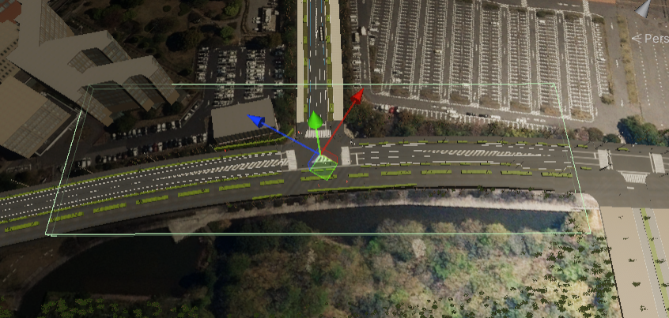
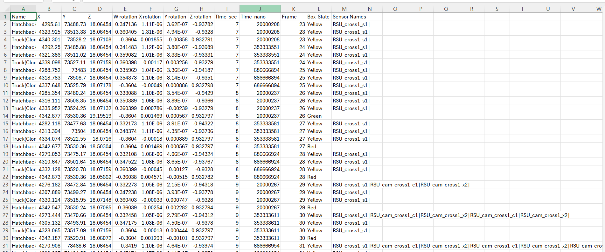
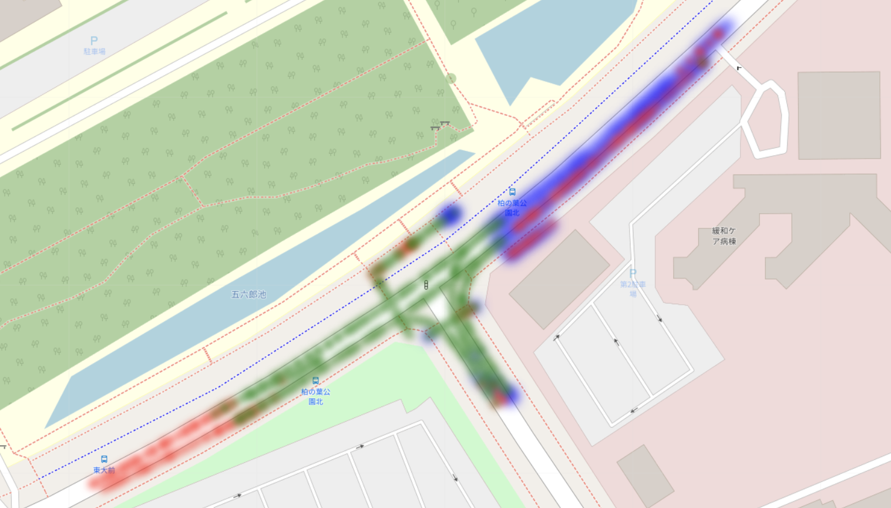
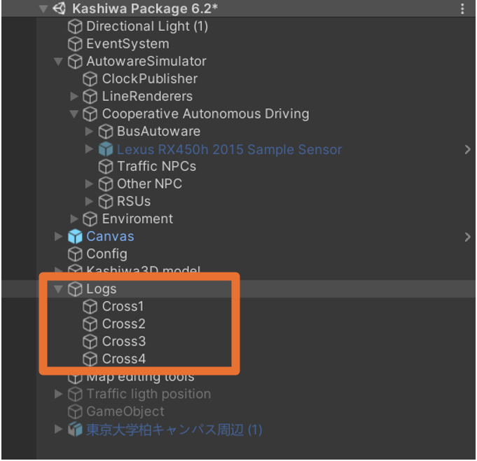
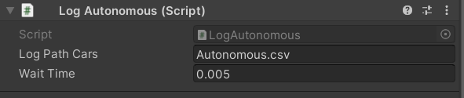
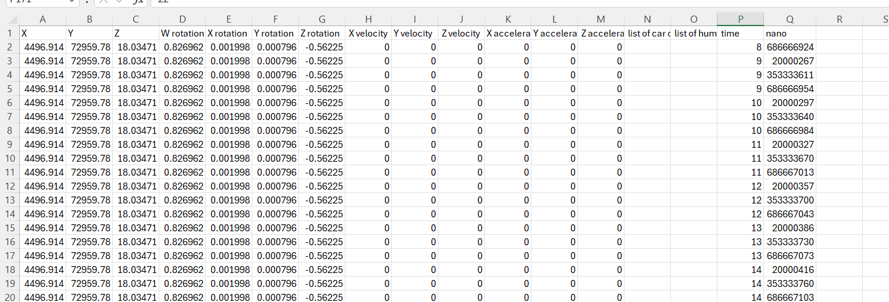

# Logs System

The simulator has two complementary logging components. **LogArea** monitors all NPCs that pass through a defined trigger zone and writes their state to CSV files. **LogAutonomous** tracks the ego vehicle's own motion and collision events, and also records spawn selection data written by the [Teleporter](../Teleport/index.md).

---

## LogArea

### What It Does

`LogArea` is a `BoxCollider` trigger that maintains live lists of vehicles and pedestrians currently inside it. Every few frames (or every few seconds), it writes a row per tracked NPC to separate CSV files for humans and cars.

  
  
The green box in the scene view marks the LogArea trigger volume.

  
  
Sample CSV output from LogArea.

---

### Logging Modes

`LogArea` supports two timing modes, controlled by the `ultraMode` toggle:

| Mode | Toggle | Field | Description |
|---|---|---|---|
| **Frame-based** | `ultraMode = true` (default) | `waitForFrame` | Log every N frames (default: 2). High-frequency output, best for smooth data. |
| **Time-based** | `ultraMode = false` | `waitTime` | Log every N seconds (default: 0.05 s). Useful when frame rate varies. |

Logging starts after a short random delay (20–30 frames). Each sample writes one row per tracked object.

---

### Detection Logic

`LogArea` uses `OnTriggerEnter` / `OnTriggerExit` to add and remove objects from its tracking lists:

| Object | Detected by | Tracked as | Requires |
|---|---|---|---|
| NPC vehicle | `NPCVehicle` component (in the collider's parents) | car | `checkCars` |
| Pedestrian | `NPCPedestrian` or `WaypointFollower` component (in the collider's parents) | human | `checkHumans` |
| Other vehicle (e.g. the ego bus) | Collider on a layer in `vehicleLayer`, with a `Rigidbody` in its hierarchy | car | `checkCars` |

Destroyed objects are removed from the lists automatically at the next sample.

---

### Sensor Column

The **Sensor Names** column contains the sensors that can currently observe the object, as reported by its `LineOfSight` component. Each entry has the form `name*points*` (sensor name and number of detected points), and entries are joined by `|`. The column is empty for objects without a `LineOfSight` component.

  

Color coding used in the companion heat-map tool:

- **Green** — NPC seen by the autonomous car
- **Red** — NPC not seen
- **Blue** — NPC detected by a roadside sensor

  
  
Typical placement of LogArea components in the scene.

---

### Inspector Fields

| Field | Default | Description |
|---|---|---|
| `logPathHumans` | — | Base path of the human CSV (a timestamped file is created per run, see [Output Files](#output-files)) |
| `logPathCars` | — | Base path of the vehicle CSV (timestamped per run) |
| `checkHumans` | true | Track pedestrians (`NPCPedestrian` / `WaypointFollower`) and create the human file |
| `checkCars` | true | Track `NPCVehicle`s and vehicle-layer bodies and create the car file |
| `waitTime` | 0.05 s | Log interval (time-based mode) |
| `waitForFrame` | 2 | Log interval in frames (frame-based mode) |
| `ultraMode` | true | Use frame-based timing |
| `checkpointJumper` | — | `CheckpointJumper` (implements `ILogIndex`) whose current index is written to the `Index` column |
| `vehicleLayer` | — | Layer mask for detecting vehicles that are not `NPCVehicle`s (e.g. the bus) |

---

### CSV Column Reference — Cars and Humans

Both files have the same 20 columns; only the first header differs (`Car ID` in the car file, `Human ID` in the human file).

| # | Column | Description |
|---|---|---|
| 1 | `Car ID` / `Human ID` | `NPCVehicle.VehicleID` for NPC vehicles; `ScenarioHumanId` for pedestrians (assigned on first log if missing). Empty for rows without either (e.g. the ego bus) |
| 2 | `Name` | GameObject name |
| 3–5 | `X`, `Y`, `Z` | Position in ROS coordinates plus the MGRS offset (m) |
| 6–9 | `W rotation`, `X rotation`, `Y rotation`, `Z rotation` | Orientation as a ROS quaternion |
| 10–11 | `Time_sec`, `Time_nano` | ROS simulation time (seconds, nanoseconds) |
| 12 | `SystemTimeMs` | Host wall-clock time, UTC Unix milliseconds |
| 13 | `Frame` | Unity frame count |
| 14 | `Box_State` | `LineOfSight` box state; `Unknown` if the object has no `LineOfSight` |
| 15 | `Sensor Names` | `name*points*` entries joined by `|` (see above) |
| 16 | `Index` | Current index of `checkpointJumper` (`ILogIndex`); 0 if unset |
| 17–19 | `X Speed`, `Y Speed`, `Z Speed` | `transform.forward × speed` (Unity world axes, not ROS) |
| 20 | `Speed Amount` | Scalar speed from the object's `ISpeed` component (m/s); 0 if it has none |

!!! note
    Numbers are always written with `.` as decimal separator, regardless of the system locale.

---

## LogAutonomous

### What It Does

`LogAutonomous` is attached directly to the ego vehicle. It continuously logs the vehicle's position, velocity, and acceleration, and records collision events. It also receives spawn selection data from the [Teleporter](../Teleport/index.md) after each teleport.

  
  
LogAutonomous component in the Inspector.

  
  
Sample CSV output from LogAutonomous.

---

### Ego Vehicle State Log

Every `waitTime` seconds (default 0.005 s, i.e. effectively every frame) LogAutonomous appends one row:

| # | Column | Description |
|---|---|---|
| 1–3 | `X`, `Y`, `Z` | Ego position in ROS coordinates plus the MGRS offset (m) |
| 4–7 | `W rotation`, `X rotation`, `Y rotation`, `Z rotation` | Ego orientation as a ROS quaternion |
| 8–10 | `X velocity`, `Y velocity`, `Z velocity` | `Rigidbody` linear velocity in the ROS frame (m/s); 0 if there is no `Rigidbody` |
| 11–13 | `X acceleration`, `Y acceleration`, `Z acceleration` | Change of velocity since the previous row divided by the elapsed time, ROS frame (m/s²); 0 on the first row |
| 14 | `list of car collisions` | Names of bodies in physical contact (`OnCollisionEnter`), joined by `|` |
| 15 | `list of human collisions` | Names of bodies inside the ego's trigger colliders (`OnTriggerEnter`), joined by `|` |
| 16–17 | `time`, `nano` | ROS simulation time (seconds, nanoseconds) |
| 18 | `system_time_ms` | Host wall-clock time, UTC Unix milliseconds |

Both collision lists only consider colliders on the `Vehicle` layer (layer 6) and store the object owning the nearest `Rigidbody`. Entries are removed on `OnCollisionExit` / `OnTriggerExit` (not cleared every frame); an empty list is written as a single space.

!!! note
    Some header names contain surrounding spaces (e.g. ` X velocity `, ` time `). Trim header names when parsing. Numbers are always written with `.` as decimal separator.

---

### Spawn Selection Log

After each teleport, the [Teleporter](../Teleport/index.md) calls `LogSpawnSelection()` on the vehicle's `LogAutonomous`, which appends a row to a separate spawn-selection CSV file.

| Column | Description |
|---|---|
| `midpoint_segment` | Name of the target midpoint lane (`None` if not set) |
| `spawn_lane` | Lane chosen for the spawn (or `RandomPoint`) |
| `sample_index` | Index of the sampled point on the spawn lane |
| `distance_to_midpoint_m` | Path distance to the midpoint (m) |
| `estimated_time_s` | Kinematic ETA to midpoint (s) |
| `target_time_s` | Randomly drawn target arrival time (s) |
| `reached_cruise` | `1` if cruise speed is reached before the midpoint, else `0` |
| `target_x`, `target_y`, `target_z` | Teleport destination in ROS map coordinates (ROS + MGRS offset, same frame as the ego log) |
| `ros_time_sec`, `ros_time_nsec` | ROS simulation time of the teleport |

This log is the primary tool for verifying that the Teleporter is placing the vehicle at the intended arrival times.

---

### Inspector Fields

| Field | Default | Description |
|---|---|---|
| `logPathCars` | — | Base path of the ego state CSV |
| `spawnSelectionLogPath` | `AutonomousSpawnValidation.csv` | Base path of the spawn selection CSV |
| `logFilePrefix` | `Auto` | Prefix added to both file names (empty = no prefix) |
| `waitTime` | 0.005 s | Interval between ego state rows |

---

## Output Files

Each run creates **new timestamped files**; nothing is appended to files from earlier runs. The timestamp is the local start time of the component.

| Component | Field | Resulting file |
|---|---|---|
| LogArea | `logPathHumans`, `logPathCars` | `<dir>/<basename>_yyyyMMdd_HHmmss<ext>` |
| LogAutonomous | `logPathCars` | `<dir>/<logFilePrefix>_<basename>_yyyyMMdd_HHmmss<ext>` |
| LogAutonomous | `spawnSelectionLogPath` | `<dir>/<logFilePrefix>_<basename>_yyyyMMdd_HHmmss<ext>` |

- `<ext>` defaults to `.csv` if the base path has no extension. An empty base path disables that file.
- The output directory is created automatically.
- Relative paths are resolved against the process working directory: the project root in the Editor, the launch directory for a player build.
- LogAutonomous logs a warning on write errors and keeps logging.

!!! note
    `SimulationOutput/` is **not** git-ignored. Keep log output out of commits manually (or write it outside the repository).

---

## Changes / Migration

Analysis scripts written for older versions need updating:

- **LogArea columns shifted:** a leading `Car ID` / `Human ID` column and a `SystemTimeMs` column (after `Time_nano`) were added. Select columns by header name rather than position.
- **One file per run:** LogArea and LogAutonomous no longer append to a fixed path; each run writes new `_yyyyMMdd_HHmmss` files (LogAutonomous files also get the `logFilePrefix`). Read the newest file or glob all runs.
- **LogAutonomous acceleration** is now the real acceleration (m/s²); previously the acceleration columns duplicated the velocity.
- **NPCPedestrian** humans are now logged by LogArea (previously only `WaypointFollower` humans).
- **LogAutonomous** gained a trailing `system_time_ms` column and the spawn-selection log.
- Numbers are written locale-independently (`.` decimal separator).
