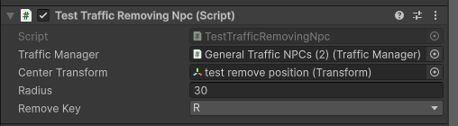

# Vehicle Despawn System

## Overview

The Vehicle Despawn System removes NPC vehicles within a specified radius. It is used before moving the ego vehicle (Bus or Lexus) to a new position, to prevent collisions with NPCs at the destination. In-code callers are the [Teleporter](../Teleport/index.md) gate and `ScenarioSelector` (Q/E/F/X start points); `TestTrafficRemovingNpc` is a manual test component.

## How It Works

The system uses a two-phase approach:

1. **Mark Phase**: Vehicles within radius are flagged for removal
2. **Despawn Phase**: Flagged vehicles are destroyed in the next `FixedUpdate()`

### System Flow
```
Game Code (Teleporter, ScenarioSelector, TestTrafficRemovingNpc)
    ↓
TrafficManager.RemoveVehiclesInRadius()
    ↓
NPCVehicleSimulator.RemoveVehiclesInRadius()
    ↓
NPCVehicleInternalState (ShouldDespawn = true)
    ↓
TrafficManager.FixedUpdate() → Despawn()
```

## Usage

### Basic Implementation
```csharp
using AWSIM.TrafficSimulation;
using UnityEngine;

public class TestTrafficRemovingNpc : MonoBehaviour
{
    [SerializeField] TrafficManager trafficManager;
    [SerializeField] Transform centerTransform;
    [SerializeField] float radius;
    [SerializeField] KeyCode RemoveKey = KeyCode.R;

    private void FixedUpdate()
    {
        if (Input.GetKeyDown(RemoveKey))
        {
            trafficManager.RemoveVehiclesInRadius(centerTransform, radius);
        }
    }
}
```

### Component Setup

<!--  -->


**Inspector Parameters**:
- **Traffic Manager**: Reference to the TrafficManager in the scene
- **Center Transform**: The center point for vehicle removal (e.g. the ego vehicle transform)
- **Radius**: Distance in meters from center point
- **Remove Key**: Keyboard key to trigger removal (default: R)

## API Reference

### RemoveVehiclesInRadius

**Overloads**:
- `TrafficManager.RemoveVehiclesInRadius(Vector3 center, float radius)`
- `TrafficManager.RemoveVehiclesInRadius(Transform centerTransform, float radius)` - uses `centerTransform.position`; logs a warning and returns `0` if the transform is null

**Parameters**:
- `center` / `centerTransform` - Center point of removal area
- `radius` (float) - Radius in meters

**Returns**: `int` - Number of vehicles marked for removal (vehicles already marked are not counted again). Returns `0` with a warning if the `NPCVehicleSimulator` is not initialized.

The call affects only the NPCs of the `TrafficManager` it is called on. If the scene has several TrafficManagers, call it on each (the Teleporter and `ScenarioSelector` do this).

## Implementation Details

### Distance Calculation

The system uses squared distance (`sqrMagnitude`) for performance:
```csharp
var distanceSquared = (state.Position - centerPosition).sqrMagnitude;
if (distanceSquared <= radiusSquared)
{
    vehicleState.ShouldDespawn = true;
}
```

### Despawn Timing

Vehicles are not destroyed immediately. Destruction occurs at the end of the next `TrafficManager.FixedUpdate()` (typically ~0.02 seconds later).

## Testing

1. Add `TestTrafficRemovingNpc` component to any GameObject
2. Assign the TrafficManager reference from the scene
3. Set the center transform (ego vehicle or target location)
4. Configure the radius (recommended: 20-30m)
5. Enter Play mode and press **R** key to test removal

## Performance Notes

- **Time Complexity**: O(n) where n is the number of active vehicles
- **Optimization**: Uses squared distance to avoid expensive square root calculations
- **Recommended Radius**: 20-30m when clearing an area around a spawn point

## Common Issues

**Vehicles still visible after pressing the key**
- Wait one `FixedUpdate()` cycle. Destruction is deferred, not immediate.

**Nothing happens when pressing the key**
- Verify TrafficManager reference is assigned in Inspector
- Check that vehicles exist within the specified radius
- Ensure the key code matches your input

**Performance drops when removing vehicles**
- Reduce the radius value
- Avoid calling the function every frame

## Notes

- The test component uses `FixedUpdate()` with `Input.GetKeyDown()` for testing purposes
- In production, call `RemoveVehiclesInRadius()` before teleporting or spawning the ego vehicle
- Vehicles marked for despawn remain in the scene until next physics update

---

**Related**: Traffic Spawning System, [Teleporter](../Teleport/index.md)