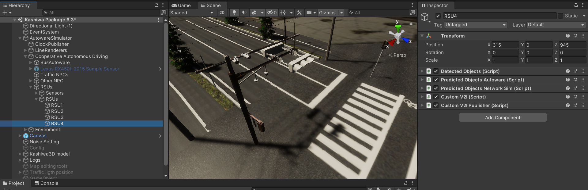
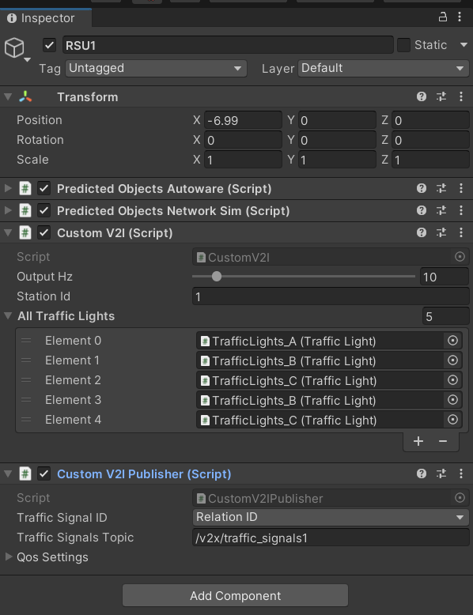
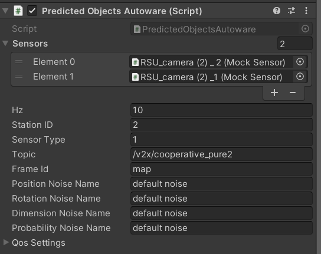

# RSU (Road Side Unit)

In our project RSUs responsible to send data of mock sensor and traffic light which are related to them selves

There are multi component that can be use in RSU 

  
  
 RSU4 with 4 pesudo sensors 

**Note** : When using the RSUs, you may find other message components added to them. These components are in the testing phase and have not been completely configured. However, if you need to use them, you can complete their fields in the code. There is no need to do anything regarding publishing or similar tasks.

## Custom V2I & Custom V2I Publisher

These two components send data about traffic lights in their topics. They are very similar to V2I and V2I Publisher in AWSIM, with one main difference: these components send data based on a predefined list rather than using the distance from the autonomous vehicle.

  
  
 Components of RSUs 

## PredictedObjectsAutoware
This component uses a list of pseudo sensors, periodically scans the objects they detect (cars and humans), and publishes them as Autoware `PredictedObjects` at the Hz assigned to the component. It also takes the names of noise categories and applies that noise to the output when publishing the ROS message.

Network effects (delay and packet loss) are generated inside the simulator: with **Enable Delayed Messages** on, the component also publishes delayed copies such as `/DSRC` and `/Cellular`, using the profiles of the `NetworkSimulator` component (**Noise and Delay Profile** object).

  
  
 PredictedObjectsAutoware component  

