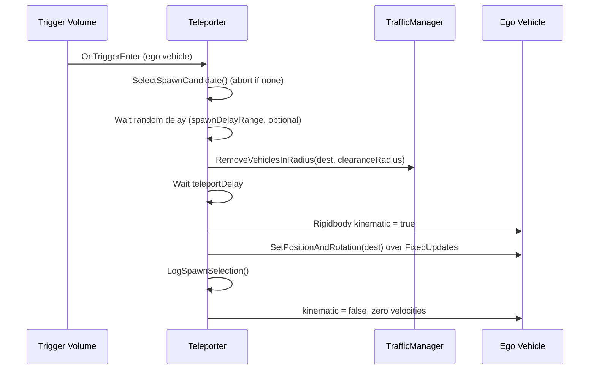
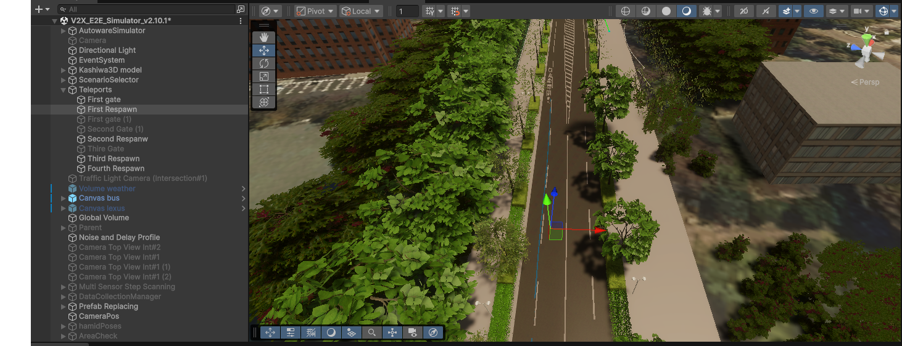
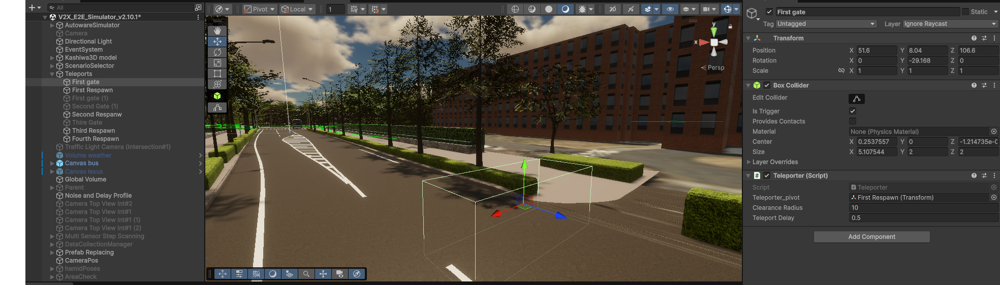

# Teleporter Component

## Overview

The `Teleporter` component is a trigger-based system that automatically relocates the ego (autonomous) vehicle to a new spawn position whenever it exits through a designated trigger volume. It handles NPC clearance at the destination, optional delays, and logs the spawn selection data for analysis.

!!! note "No hotkeys"
    The Teleporter gate is triggered only by the ego vehicle entering its collider; it has no keyboard shortcuts. The Q/E/F/X keys described in the [QuickStart](../../GettingStarted/QuickStartDemo/index.md) belong to a different feature (`ScenarioSelector` start points).

!!! info "Key Design Goal"
    The Teleporter is designed for **repeatable, controlled experiments**: by targeting a midpoint lane segment with a randomized arrival time, each run places the ego vehicle at a different distance from a point of interest while keeping the scenario statistically comparable.

---

## Spawn Strategies

The Teleporter supports two independent strategies, selectable from the Inspector.

=== "LaneMidpoint (default)"

    Samples candidate spawn positions along a set of configured `TrafficLane` objects, then picks the candidate whose **estimated travel time** to a target midpoint lane is closest to a randomly drawn target time.

    This strategy guarantees that the ego vehicle is placed at a realistic driving distance from the point of interest — far enough to observe natural traffic behaviour before reaching it.

=== "RandomPoint"

    Picks a random `Transform` from a hand-placed list of `RandomSpawnPoint` entries. Only valid entries (non-null entry with an assigned `point`) are considered. Each entry can optionally override the rotation with a custom Euler angle.

    Use this strategy when you need full manual control over spawn positions without any ETA logic.

---

## LaneMidpoint Strategy in Detail

### Candidate Generation

The Teleporter walks through all `LaneSpawnSource` entries and samples each lane at regular intervals defined by `spawnSubdivisionSpacing` (default 10 m):

```
Lane waypoints → cumulative distance table → sample every N metres
```

If `includeSegmentEndpoints` is enabled, sampling starts at the lane start (0 m) and the lane end (lane length) is always added as a candidate, even when the length is not a multiple of the spacing. If it is disabled, sampling starts at `spawnSubdivisionSpacing` and the lane end is only included when it falls on a sample. The spacing is clamped to at least 1 m.

For each sample, the component caches:

- World position (interpolated along the lane waypoints)
- Forward direction (used to orient the vehicle on spawn)

### Distance Calculation (Dijkstra)

For each candidate, the Teleporter computes the driving distance to the configured `midpointSegment` lane. When the candidate is on a different lane than the midpoint, it runs a lightweight Dijkstra search through the lane graph (`NextLanes` connections):

```
cost(start_lane) = lane_length - distance_from_start
cost(next_lane)  = cost(current_lane) + next_lane_length
...
stop when midpointSegment is reached
```

Candidates with no reachable path to the midpoint are excluded, as are candidates on the midpoint lane itself that lie past the target point.

### ETA Calculation

Travel time is estimated with a two-phase kinematic model (acceleration + cruise):

$$
t = \begin{cases}
\sqrt{\dfrac{2d}{a}} & \text{if } d \leq \dfrac{v_c^2}{2a} \\[10pt]
\dfrac{v_c}{a} + \dfrac{d - \dfrac{v_c^2}{2a}}{v_c} & \text{otherwise}
\end{cases}
$$

Where:

- $d$ = distance to midpoint (metres)
- $v_c$ = cruise speed (`cruiseSpeedKmh` converted to m/s)
- $a$ = assumed acceleration (`assumedAcceleration`)

### Target Time Selection

Each teleport draws a random target arrival time uniformly from `targetArrivalWindow`:

```
t_target ~ Uniform(targetArrivalWindow.x, targetArrivalWindow.y)
```

The candidate with the smallest `|ETA - t_target|` is selected.

---

## Teleport Sequence and NPC Clearance

When a `Vehicle` enters the trigger, the Teleporter runs one coroutine per vehicle in this order:

1. **Pick the destination** with the selected spawn strategy. If no candidate is found (empty `laneSpawnSources`, missing or unreachable `midpointSegment`, or no valid random points), it logs the warning `Teleporter: No spawn candidate available. Aborting teleport.` and does nothing.
2. **Optional random delay** drawn from `spawnDelayRange` (only if `spawnDelayRange.y > 0`). The ego vehicle keeps driving during this delay.
3. **Clear NPCs**: calls `RemoveVehiclesInRadius(destination, clearanceRadius)` on every `TrafficManager` found in the scene at `Awake`. Clearing happens after the random delay, right before the teleport, so NPCs have little time to drive back into the cleared area.
4. **Wait `teleportDelay`** seconds so the marked NPCs are despawned (see [NPC Cars](../NpcCars/index.md)).
5. **Move the ego**: sets the Rigidbody kinematic and sets the pose over several `FixedUpdate` steps.
6. **Log** the selection via `LogAutonomous.LogSpawnSelection()` (if the vehicle has that component).
7. **Restore physics**: Rigidbody non-kinematic, position/rotation set, linear and angular velocity zeroed. After two more `FixedUpdate` steps the vehicle can trigger the gate again.



!!! note "Disabling the gate"
    If the Teleporter is disabled while a teleport is in progress, `OnDisable` makes the affected vehicles' Rigidbodies non-kinematic again and clears the in-progress set, so new teleports are allowed once it is re-enabled.

---

## Inspector Reference

### Teleport Timing

| Field | Default | Description |
|---|---|---|
| `clearanceRadius` | 10 m | Radius around destination to clear NPC vehicles |
| `teleportDelay` | 0.5 s | Fixed wait after NPC clearance, before teleport |
| `spawnDelayRange` | `(0, 0)` | Random delay before NPC clearance: X = min, Y = max. Set Y > 0 to enable. The ego keeps driving during this delay. |

### Strategy Selection

| Field | Default | Description |
|---|---|---|
| `spawnStrategy` | `LaneMidpoint` | `LaneMidpoint` or `RandomPoint` |

### Lane-Based (Midpoint Targeting)

| Field | Default | Description |
|---|---|---|
| `laneSpawnSources` | — | Lanes to sample candidates from |
| `spawnSubdivisionSpacing` | 10 m | Distance between sampled points along each lane |
| `includeSegmentEndpoints` | true | Include lane start and end as candidates |
| `midpointSegment` | — | The target lane for ETA calculation |
| `midpointSegmentFraction` | 0.5 | Normalised position on midpoint lane (0 = start, 1 = end) |
| `cruiseSpeedKmh` | 30 km/h | Cruise speed for ETA estimation |
| `assumedAcceleration` | 2 m/s² | Acceleration for ETA estimation |
| `targetArrivalWindow` | `(0, 90)` s | Random range for target arrival time |

### Random Spawn Points

| Field | Description |
|---|---|
| `randomSpawnPoints` | List of entries used by the `RandomPoint` strategy, each with a `point` (`Transform`) |
| `useCustomRotation` | Per-entry toggle to override rotation with `customEulerRotation` |
| `customEulerRotation` | Euler angles (degrees) used when `useCustomRotation` is enabled |

!!! note "Custom rotation of (0, 0, 0)"
    A `customEulerRotation` of exactly `(0, 0, 0)` is treated as "not set": the point's own rotation is used even if `useCustomRotation` is enabled. To face world +Z, use a tiny non-zero value (e.g. `(0, 0.01, 0)`) or rotate the point's `Transform` instead.

---

## Spawn Selection Logging

After every teleport, the Teleporter calls `LogSpawnSelection()` on the ego vehicle's `LogAutonomous` component (if present). This writes one row to the spawn selection CSV:

| Column | Description |
|---|---|
| `midpoint_segment` | Name of the target midpoint lane (`None` if not assigned) |
| `spawn_lane` | Name of the selected spawn lane (or `RandomPoint`) |
| `sample_index` | Index of the sample point on the spawn lane (for `RandomPoint`: index in `randomSpawnPoints`) |
| `distance_to_midpoint_m` | Dijkstra path distance to midpoint (m) |
| `estimated_time_s` | Kinematic ETA to midpoint (s) |
| `target_time_s` | Randomly drawn target arrival time (s) |
| `reached_cruise` | `1` if cruise speed is reached before the midpoint, else `0` |
| `target_x`, `target_y`, `target_z` | Teleport destination in ROS map coordinates (MGRS local), the same frame as the ego log |
| `ros_time_sec`, `ros_time_nsec` | ROS time of the teleport |

For the `RandomPoint` strategy, `distance_to_midpoint_m`, `estimated_time_s` and `target_time_s` are `0` and `reached_cruise` is `0`.

The file is named `<logFilePrefix>_<name>_yyyyMMdd_HHmmss.csv`, where `<name>` comes from `spawnSelectionLogPath` (default `AutonomousSpawnValidation.csv`) and `logFilePrefix` defaults to `Auto`. The file is created in the directory of `spawnSelectionLogPath`, which is created automatically if missing.

See [Loggers](../Logger/index.md) for details on the full CSV output.

---

## Scene Setup

### Step 1 — Create the Trigger Volume

1. Create an empty GameObject.
2. Add a **BoxCollider** and enable **Is Trigger**.
3. Scale it to cover the exit area of your road loop.
4. Attach the **Teleporter** script.

### Step 2 — Configure Lanes (LaneMidpoint strategy)

1. In the Inspector, add entries to **Lane Spawn Sources** and assign `TrafficLane` objects that cover the valid spawn zone.
2. Assign the **Midpoint Segment** — the lane the ego vehicle should be heading toward on each run.
3. Adjust `cruiseSpeedKmh` and `assumedAcceleration` to match the ego vehicle's expected behaviour.

### Step 3 — Tune the Arrival Window

Set `targetArrivalWindow` to the range of arrival times you want to study. For example:

- `(10, 60)` s → the selected spawn has an estimated arrival time close to a random value between 10 and 60 s (limited by the available candidates)
- `(0, 0)` → vehicle always spawns as close to the midpoint as possible

To see which arrival times your lanes can actually produce, add the **TeleporterDebug** component to any GameObject and assign the Teleporter (if left empty, it uses the first Teleporter found). When the component is enabled it logs to the Console each source lane's length, the total length, and the range of ETAs from the closest to the farthest spawn sample to the midpoint target. Choose a `targetArrivalWindow` inside that range. `TeleporterDebug` is editor-only; it does nothing in player builds.

<div align="center">
    <br/>
    <em>Figure 1: Final vehicle position after teleport</em>
</div>
<div align="center">
    <br/>
    <em>Figure 2: Trigger gate and BoxCollider in the scene</em>
</div>

---

## Tips and Best Practices

!!! tip "Lane Coverage"
    Add lanes that span the full approach zone to the midpoint. More candidates give the system more flexibility to match the target arrival time precisely.

!!! tip "Clearance Radius"
    Set `clearanceRadius` large enough to prevent the ego vehicle from spawning inside an NPC. A value of 10–15 m is usually sufficient.

!!! warning "Midpoint Must Be Reachable"
    If no candidate has a connected path (via `NextLanes`) to the `midpointSegment`, the teleport is aborted with the warning `No spawn candidate available. Aborting teleport.` and the ego keeps driving. `TeleporterDebug` reports `Could not compute distance to midpoint` in this case.

!!! info "Re-trigger Prevention"
    The Teleporter internally tracks which vehicles are currently being teleported (`teleportingVehicles` HashSet), so a vehicle re-entering the trigger during the delay phase is ignored.
