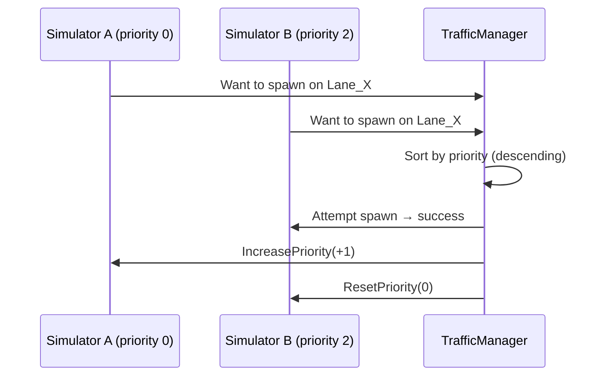
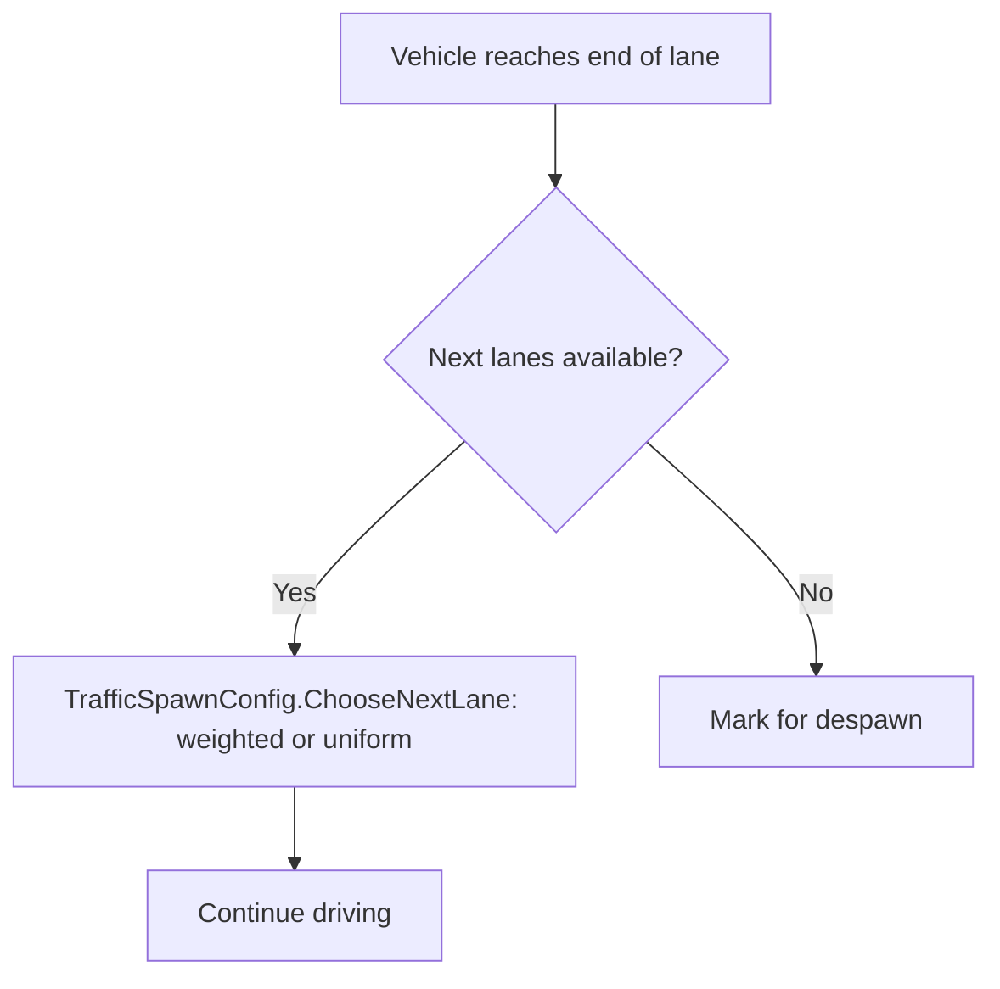

# Random Traffic Simulator

## Overview

The `RandomTrafficSimulator` is responsible for continuously spawning NPC vehicles across a configurable set of lanes. It works within the [TrafficManager](../TrafficManager/index.md) pipeline and supports per-lane spawn rate control, weighted lane-change probabilities, and a maximum-spawn lifetime.

---

## Core Concepts

### Spawnable Lanes

Each `RandomTrafficSimulator` instance is given a list of `SpawnableLaneConfig` entries — one per lane it is allowed to use as a spawn point:

```csharp
public struct SpawnableLaneConfig {
    public TrafficLane lane;
    public float spawnsPerMinute;   // 0 = no rate limit
}
```

Every `FixedUpdate`, the simulator picks a random spawn point from this list and hands it to the `TrafficManager`. If the spawn is not possible (lane occupied, too close to the ego vehicle, rate limit not elapsed, `maxVehicleCount` reached), it is skipped; on the next frame a new random lane is picked. The chosen prefab is kept until it is actually spawned, so large vehicles are not starved by small ones.

Entries with no lane assigned are ignored. A simulator with **no valid spawnable lane** is treated as disabled.

!!! warning "Upgrading older scenes"
    `spawnableLanes` used to be a plain `TrafficLane[]`. Scenes saved with that format show empty `{lane, spawnsPerMinute}` entries after the upgrade and must be relinked in the Inspector.

### Maximum Spawns

Setting `maximumSpawns > 0` gives the simulator a finite lifetime: it deactivates itself after spawning that many vehicles. This is useful for scripted scenarios where you want exactly N cars on a route.

```
maximumSpawns = 0  →  unlimited (run forever)
maximumSpawns = N  →  deactivate after N spawns
```

### Priority System

When two or more simulators request the same spawn lane at the same time, `TrafficManager` resolves the conflict using a fair round-robin priority counter:



Each time a simulator loses the race it gains +1 priority, so it will eventually win. This prevents large-vehicle simulators from monopolising lanes over smaller ones.

---

## Branch Weights

By default, when a vehicle reaches the end of its current lane and has multiple `NextLanes` to choose from, the next lane is picked uniformly at random. **Branch weights** let you bias that choice.

### Configuring in the Inspector

Each `RandomTrafficSimulatorConfiguration` exposes a `branchWeights` array (entries with an unassigned lane or a weight ≤ 0 are ignored):

```
BranchWeightSet:
  fromLane: Lane_A1
  next:
    - nextLane: Lane_B1,  weight: 2.0
    - nextLane: Lane_B2,  weight: 1.0
```

In the example above, vehicles leaving `Lane_A1` will choose `Lane_B1` approximately twice as often as `Lane_B2`.

### Configuring via JSON

Branch weights can also be loaded from `Assets/Configs/traffic_spawn.json` (managed by [TrafficSpawnConfig](../TrafficSpawnConfig/index.md)), which makes it easy to iterate without reopening the Unity Editor:

```json
{
  "branchWeights": [
    {
      "fromLane": "Lane_A1",
      "next": [
        { "lane": "Lane_B1", "weight": 2.0 },
        { "lane": "Lane_B2", "weight": 1.0 }
      ]
    }
  ]
}
```

Weights are normalised automatically; only their ratios matter.

!!! note "Branch weights are global"
    - Branch weights are stored in the static [TrafficSpawnConfig](../TrafficSpawnConfig/index.md), keyed by `fromLane`. They apply to **every** NPC vehicle choosing a next lane from that lane, regardless of which simulator spawned it. If two simulators define the same `fromLane`, the later entry wins.
    - When a spawn config JSON is loaded, its `branchWeights` **replace** the Inspector branch weights.
    - With several `TrafficManager`s, the last one to initialize (or load a config) defines the weights.
    - Next lanes that have no weight are never chosen while at least one listed lane is available. If none of the listed lanes is among the current `NextLanes`, the choice falls back to uniform.

---

## Per-Lane Spawn Rates

Each lane entry has a `spawnsPerMinute` field. `TrafficManager` converts this to a minimum interval between spawns on that lane:

$$
\text{interval} = \frac{60}{\text{spawnsPerMinute}} \text{ seconds}
$$

If `spawnsPerMinute = 0`, there is no rate limit and vehicles spawn as fast as the lane clears.

!!! info "Maximum rate, not a guaranteed rate"
    `spawnsPerMinute` is a cap: it enforces a minimum interval between spawns on that lane. The observed rate is usually lower, because the lane is picked at random among the simulator's lanes and a spawn also needs free space at the spawn point, fewer than `maxVehicleCount` vehicles, and enough distance to the ego vehicle.

Spawn rates can also be loaded from the same JSON file:

```json
{
  "spawnRates": [
    { "lane": "Lane_A1", "spawnsPerMinute": 6.0 },
    { "lane": "Lane_B2", "spawnsPerMinute": 3.5 }
  ]
}
```

---

## Configuration Reference

### `RandomTrafficSimulatorConfiguration` Fields

| Field | Description |
|---|---|
| `npcPrefabs` | Array of vehicle prefabs to spawn randomly |
| `spawnableLanes` | `SpawnableLaneConfig` entries: lane + optional `spawnsPerMinute` |
| `branchWeights` | Weighted next-lane preferences per lane |
| `maximumSpawns` | Total spawns before this simulator stops (0 = unlimited) |
| `enabled` | Toggle the entire simulator on/off |

---

## How Vehicles Navigate

Once spawned, an NPC vehicle is handed off to `NPCVehicleSimulator`, which runs the **Cognition → Decision → Control** pipeline each `FixedUpdate`. Route extension works as follows:



See [TrafficManager](../TrafficManager/index.md) for details on the full simulation pipeline.

---

## Adding a New RandomTrafficSimulator

1. Open the **TrafficManager** component in the Inspector.
2. Expand the **Random Traffic Sims** array and add a new entry.
3. Assign NPC prefabs and spawnable lanes.
4. Optionally configure branch weights or set a `spawnsPerMinute` per lane.
5. Optionally save the configuration to JSON using the **Save Spawn Config JSON** context menu on `TrafficManager`.

!!! tip
    You can have multiple `RandomTrafficSimulator` entries targeting different sets of lanes — for example, one for main roads and another for side streets with lower density.
