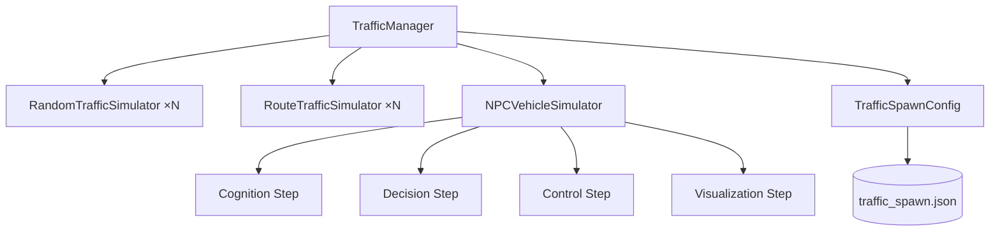
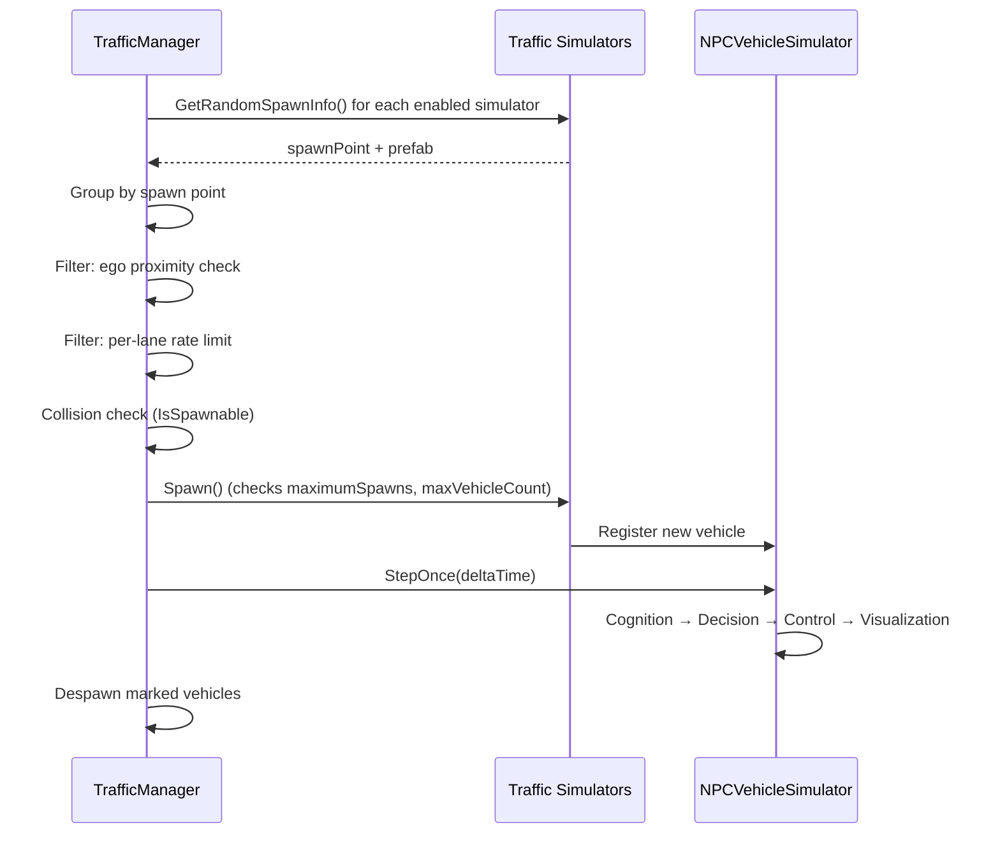
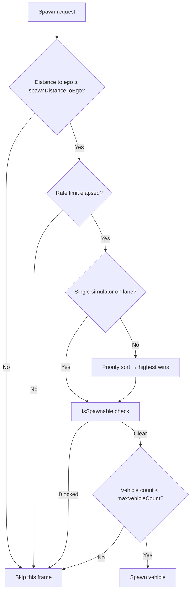
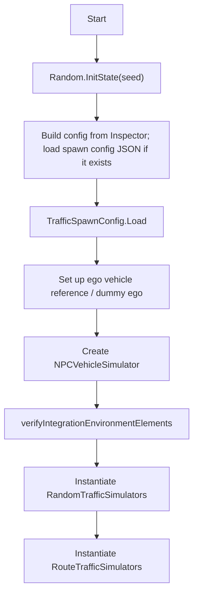

# Traffic Manager System

!!! info "Overview"
    The **Traffic Manager** is the central orchestrator for all NPC vehicle simulation. It manages multiple traffic simulators, controls spawn rate and density, enforces ego-vehicle safety distances, and handles the full lifecycle of NPC vehicles — from instantiation to despawn.

---

## Core Architecture



### System Components

=== "Traffic Simulators"

    The manager supports two simulator types running simultaneously:

    - **RandomTrafficSimulator** — spawns vehicles randomly across a set of lanes, with optional per-lane rates and branch weights. See [Random Traffic](../Traffic/index.md).
    - **RouteTrafficSimulator** — spawns vehicles that follow a fixed multi-lane route.

    Both implement `ITrafficSimulator`, giving the manager a uniform interface for spawn requests.

=== "NPC Vehicle Simulator"

    The core physics engine that steps all active NPC vehicles each `FixedUpdate`:

    ```mermaid
    graph LR
        A[Cognition] --> B[Decision]
        B --> C[Control]
        C --> D[Visualization]
    ```

    The cognition step uses Unity Job System parallel jobs (`IJobParallelFor`) and batched physics queries (`RaycastCommand` / `BoxcastCommand`) for ground, obstacle and curve checks.

=== "TrafficSpawnConfig"

    A static configuration layer filled from `Assets/Configs/traffic_spawn.json` (or from the Inspector data when the file is missing). It holds the branch weights used by the next-lane choice of every NPC vehicle and records branch-decision statistics. Per-lane spawn rates are enforced by `TrafficManager` itself. See [TrafficSpawnConfig](../TrafficSpawnConfig/index.md).

---

## Inspector Reference

### General

| Field | Default | Description |
|---|---|---|
| `seed` | 0 | Seed for Unity's random generator. `Random.InitState(seed)` is called at the start of every initialization, so the same seed reproduces the same random choices (prefabs, spawn lanes, branch decisions) as long as the scene is otherwise deterministic. |

!!! note "Setting the seed"
    - **Inspector:** `seed` field on the `TrafficManager` component.
    - **JSON configuration** (passed on the command line in player builds, or via `useJsonConfig` in the Editor): the `RandomTrafficSeed` key of the `AutowareSimulation` configuration file is written to `TrafficManager.seed` (and `MaxVehicleCount` to `maxVehicleCount`) in `Awake`, before the manager initializes.
    - **Script:** `Restart(newSeed, newMaxVehicleCount)` (see [Restart](#restart)).

### NPC Vehicle Settings

| Field | Default | Description |
|---|---|---|
| `vehicleConfig` | See below | Motion parameters for all NPC vehicles |
| `vehicleLayerMask` | — | Layer for vehicle-to-vehicle raycasting |
| `groundLayerMask` | — | Layer for ground-following raycasts |
| `maxVehicleCount` | 40 | Maximum simultaneous NPC vehicles |
| `spawnDistanceToEgo` | 50 m | Minimum 2D distance from the ego vehicle to a spawn point |
| `egoVehicle` | — | Reference to the ego. If unset, a dummy is created automatically. |
| `trafficLanesObject` | — | Parent GameObject containing all `TrafficLane` components. If unset, the manager falls back to `GameObject.Find("TrafficLanes")`. If neither exists, an error is logged and lane verification is skipped. |

### Traffic Simulators

| Field | Description |
|---|---|
| `randomTrafficSims` | `RandomTrafficSimulatorConfiguration` entries. See [Random Traffic](../Traffic/index.md). |
| `routeTrafficSims` | `RouteTrafficSimulatorConfiguration` entries (fixed route). |

### Spawn Config

| Field | Default | Description |
|---|---|---|
| `spawnConfigPath` | `Assets/Configs/traffic_spawn.json` | Path to load/save spawn rates and branch weights. A relative path is resolved against the project root (`Application.dataPath/..`); an absolute path is used as-is. |

### Debug

| Field | Description |
|---|---|
| `showGizmos` | Master toggle for all debug gizmos |
| `showYieldingPhase` | Visualise intersection yield states |
| `showObstacleChecking` | Visualise obstacle detection rays |
| `showSpawnPoints` | Draw cyan cubes at all spawn lane starts |

---

## NPCVehicleConfig Parameters

| Parameter | Default | Description |
|---|---|---|
| `Acceleration` | 3 m/s² | Normal forward acceleration |
| `Deceleration` | 2 m/s² | Gentle braking |
| `SuddenDeceleration` | 4 m/s² | Obstacle braking |
| `AbsoluteDeceleration` | 20 m/s² | Physics-limit emergency braking |
| `SpeedLimitSource` | `LaneletSpeedLimit` | `LaneletSpeedLimit` (use the current lane's speed limit) or `FixedSpeedLimit` |
| `SpeedLimit` | 13.89 m/s (50 km/h) | Fixed speed limit, used only when `SpeedLimitSource` is `FixedSpeedLimit` |

---

## Spawn Configuration (JSON)

`TrafficManager` can save and load a JSON file that controls per-lane spawn rates and branch weights. This makes it easy to tune traffic density without reopening the Unity Editor.

### Context Menu Actions

Right-click on the `TrafficManager` component in the Inspector:

- **Save Spawn Config JSON** — writes current rates/weights from all simulators to the JSON file.
- **Load Spawn Config JSON** — reads the JSON file and applies it to all simulators.

The config is also loaded automatically at scene start if the file exists (otherwise a warning is logged and the Inspector values are used). At runtime, `SetSpawnConfigPath(path)` changes the path and loads it immediately; the **Traffic Settings** UI (`TrafficSettingsUI`) uses `GetSpawnConfigPath()` / `SetSpawnConfigPath()` for this.

!!! warning "Player builds"
    A relative path is resolved against `Application.dataPath/..`. In a player build that is the build folder, so the default file must be copied to `<build folder>/Assets/Configs/traffic_spawn.json` (or use an absolute path).

!!! note "What a loaded file overrides"
    - `branchWeights` from the file **replace** the Inspector branch weights of every random traffic simulator.
    - `spawnRates` overwrite `spawnsPerMinute` only for lanes listed in the file. Rate limiting is rebuilt from the file, so spawnable lanes not listed in it are not rate-limited while that file is loaded.
    - `TrafficSpawnConfig` is static: with several `TrafficManager`s, the last one to initialize or load defines the global branch weights.

### JSON Format

```json
{
  "spawnRates": [
    { "lane": "Lane_A1", "spawnsPerMinute": 6.0 },
    { "lane": "Lane_B2", "spawnsPerMinute": 3.5 }
  ],
  "branchWeights": [
    {
      "fromLane": "Lane_A1",
      "next": [
        { "lane": "Lane_B1", "weight": 2.0 },
        { "lane": "Lane_B2", "weight": 1.0 }
      ]
    }
  ]
}
```

- Lane names are **case-insensitive**.
- `spawnsPerMinute = 0` disables rate limiting for that lane.
- Weights are normalised automatically; only ratios matter.

### Per-Lane Rate Limiting

When a spawn rate is set for a lane, `TrafficManager` tracks the last spawn time per lane and skips spawn attempts until the interval has elapsed:

$$
\text{interval (s)} = \frac{60}{\text{spawnsPerMinute}}
$$

!!! info "Maximum rate, not a guaranteed rate"
    `spawnsPerMinute` only enforces a minimum interval between spawns on a lane. The actual rate is usually lower, because each frame a simulator picks one of its lanes at random and the spawn also requires a free spawn area, `maxVehicleCount` not reached, and enough distance to the ego vehicle.

---

## RemoveVehiclesInRadius

The Teleporter (and the ScenarioSelector) call this method before moving the ego vehicle to its new spawn position. All NPC vehicles within `radius` metres of `center` are marked for despawn and removed on the next `FixedUpdate`.

```csharp
// By world position
int count = trafficManager.RemoveVehiclesInRadius(position, radius);

// By transform
int count = trafficManager.RemoveVehiclesInRadius(transform, radius);
```

Returns the number of vehicles removed.

---

## Simulation Pipeline

### Fixed Update Cycle



### Spawn Decision Logic



A `RandomTrafficSimulator` is only queried while it is enabled, has at least one valid spawnable lane, and has not reached `maximumSpawns`. A simulator whose spawnable lanes are all unassigned is treated as disabled.

---

## NPC Vehicle Simulation Pipeline

### Step 1 — Cognition

Uses Unity Job System jobs and batched physics queries. Each vehicle gathers:

- Ground existence (vehicle must be above valid surface)
- Next lane and waypoint
- Traffic light state and passability
- Right-of-way at intersections
- Curve detection (upcoming sharp turns → reduce speed)
- Front obstacle distance
- Occupied zebra crossings ahead, via `ZebraCrossingArea.TryGetBlockedStop()` (see [Zebra Crossing](../ZebraCrossing/index.md))

### Step 2 — Decision

Determines each vehicle's immediate action:

| Speed Mode | Trigger |
|---|---|
| `NORMAL` | Open road, green light |
| `SLOW` | Approaching curve or distant obstacle |
| `STOP` | Red light, pedestrian crossing, intersection yield |
| `SUDDEN_STOP` | Close obstacle, blocked crossing |
| `ABSOLUTE_STOP` | Emergency physics limit |

The decision step takes the minimum of the stop distances for the front vehicle, traffic light, right-of-way and an occupied zebra crossing (computed in the cognition step) and picks the speed mode from it. See [Zebra Crossing](../ZebraCrossing/index.md).

### Step 3 — Control

Updates vehicle kinematics:

- Speed adjusted toward target via acceleration/deceleration ramp
- Steering computed from angle to next waypoint
- Position and rotation applied to the Unity transform

### Step 4 — Visualization

- Applies computed transform to the NPC GameObject
- Updates turn signal state based on upcoming lane

---

## Traffic Light Integration

Follows the Vienna Convention:

| State | NPC Behaviour |
|---|---|
| 🟢 Green | Proceed normally |
| 🟡 Yellow | Stop if distance allows; otherwise commit |
| 🔴 Red | Stop at stop line |

Yellow light decision:

```
if distance_to_light < sudden_stop_distance:
    commit (cannot stop safely)
else:
    stop
```

---

## Intersection Right-of-Way

NPC vehicles use a yield phase system at intersections:

| Phase | Meaning |
|---|---|
| `NONE` | Not yielding |
| `ENTERING_INTERSECTION` | Approaching an intersection; evaluating whether to yield (no stop) |
| `AT_INTERSECTION` | Inside the intersection; evaluating whether to yield (no stop) |
| `LANES_RULES_ENTERING_INTERSECTION` / `LANES_RULES_AT_INTERSECTION` | Yielding based on the lanes' right-of-way rules |
| `LEFT_HAND_RULE_ENTERING_INTERSECTION` / `LEFT_HAND_RULE_AT_INTERSECTION` | Yielding under the left-hand rule to another nearby vehicle |
| `INTERSECTION_BLOCKED` | Waiting before entering because the intersection is busy |
| `FORCING_PRIORITY` | Yielding inside the intersection to a vehicle that is forcing its priority |

---

## Lifecycle Management

### Initialization (`Start`)



A missing lanes parent does not stop initialization (only the lane verification is skipped). If the manager is not initialized (simulator list not created), `FixedUpdate` logs an error and returns instead of throwing.

### Restart

```csharp
trafficManager.Restart(newSeed: 42, newMaxVehicleCount: 20);
```

Disposes all current state, sets `seed` and `maxVehicleCount`, and re-runs initialization (including reloading the spawn config). Both parameters have defaults (`newSeed = 0`, `newMaxVehicleCount = 10`), so omitted arguments reset those values rather than keeping the current ones.

### Destroy

On `OnDestroy`, the manager first disposes the `NPCVehicleSimulator`, then calls `TrafficSpawnConfig.ExportBranchDecisionCsv()` to write the branch decision statistics to `Assets/Configs/traffic_branch_decisions.csv` (relative to the project root). Export errors are logged as warnings. See [TrafficSpawnConfig](../TrafficSpawnConfig/index.md) for the CSV format.

---

## Scene Setup Checklist

!!! check "Required before Play"
    - [ ] The lanes parent is assigned to **`trafficLanesObject`**, or a GameObject named **`TrafficLanes`** exists in the scene.
    - [ ] All `TrafficLane` child objects have **unique names**.
    - [ ] At least one `TrafficLane` has **`intersectionLane = true`**.
    - [ ] `TrafficManager.vehicleLayerMask` and `groundLayerMask` are assigned.
    - [ ] At least one `RandomTrafficSimulatorConfiguration` entry is configured, with its spawnable lanes assigned.

The first three items are validated at startup (`verifyIntegrationEnvironmentElements`); errors appear in the Console with descriptive messages.

!!! warning "Upgrading older scenes"
    `spawnableLanes` changed from a plain `TrafficLane[]` to `SpawnableLaneConfig` entries (`{lane, spawnsPerMinute}`). Scenes saved with the old format show empty lanes and must be relinked in the Inspector; until then the simulator has no valid spawn lane and is treated as disabled.

---

## Extensibility

Custom simulators can be added at runtime via:

```csharp
trafficManager.AddTrafficSimulator(new MyCustomSimulator(...));
```

Any class implementing `ITrafficSimulator` integrates automatically with the priority system and spawn loop.
