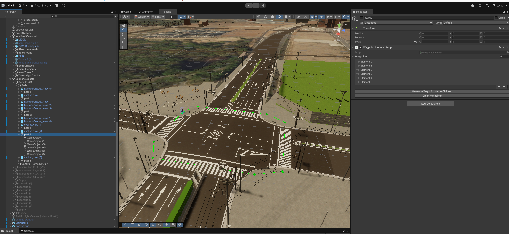
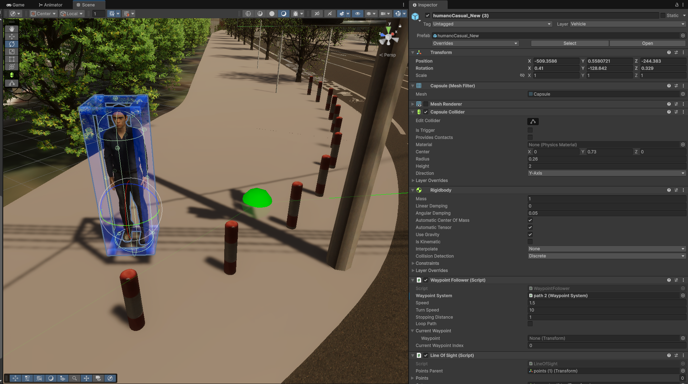
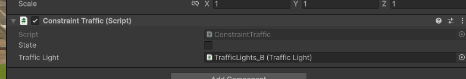

# Pedestrian & Cyclist Path System

## Overview

This system controls the movement of pedestrians and cyclists along defined paths in the scene. It is built from these cooperating components:

| Component | Role |
|---|---|
| `WaypointSystem` | Defines an ordered sequence of path points |
| `WaypointFollower` | Moves a character along a `WaypointSystem` |
| `HumanNpcSpawner` | Pool-based spawner that assigns NPCs to randomly chosen paths |
| `SpawnerOnWaypoint` | Manual or timed spawner for a single path |
| `SpawnerOnWaypoint2` | Timed spawner that picks a random prefab and a random spawn point / path |
| `ScenarioHumanId` | Assigns a unique ID to each spawned human |

!!! note "JSON-driven paths"
    Paths can also be defined in a JSON file instead of being placed by hand. In the `NormalTraffics` scenario of the Kashiwa scene, pedestrians and cyclists are spawned this way by `PedestrianCyclistSpawner`. See [Path Spawn Config (JSON)](../PathSpawnConfig/index.md).

---

## WaypointSystem

This component should be added to a **parent GameObject**. Child `Transform` objects define the waypoint positions in sequence.

### Setup

1. Create a parent GameObject (e.g., `Path_Sidewalk_A`).
2. Add child `Transform` objects at each waypoint position.
3. Add the `WaypointSystem` component to the parent.
4. Click **Clear Waypoints**, then **Generate Waypoints from Children** — this populates the list in order.

If **Gizmos** are enabled, the path is drawn as:

- **Spheres** at the waypoints
- **Green lines** connecting consecutive waypoints
- A closing line from last to first when `loopStatus = true`

Empty (`None`) waypoint slots are skipped when drawing the gizmos, so a half-edited list does not throw errors in the Scene view. At runtime, however, every slot must reference a `Transform`.

<div style="text-align: center;">
  
  <p>Green line in the Scene view and <code>WaypointSystem</code> in the Inspector.</p>
</div>

### Key Properties and Methods

| Member | Description |
|---|---|
| `loopStatus` | When true, the follower wraps from the last waypoint back to the first. When false, the follower is deactivated at the last waypoint (returned to the pool) |
| `GetFirstWaypoint()` | Returns the first waypoint `Transform` |
| `GetClosestWaypoint(position)` | Finds the nearest `WaypointNode` to a world position |
| `GetClosestWaypointIndex(position)` | Returns the index of the nearest waypoint |
| `GetNextWaypointIndex(index)` | Returns `(index + 1) % count` |
| `GetWaypointByIndex(index)` | Direct index access |
| `GenerateWaypointsFromChildren()` | Auto-populates the list from child transforms |
| `EndPathCheck(index)` | Returns true when `index == count - 1` |

---

## WaypointFollower

By adding a `WaypointFollower` component to a pedestrian or cyclist, it will automatically navigate toward successive waypoints in the assigned `WaypointSystem`.

Assign the target path via the `waypointSystem` field in the Inspector, or from code:

| Method | Description |
|---|---|
| `SetWaypointSystem(ws)` | Assigns the path and starts from the waypoint **closest** to the current position |
| `ForceStartAtFirstWaypoint()` | Teleports the character to the first waypoint and starts from index 0 |

When a non-looping path ends (or the character falls below y = -200), the follower stops the rigidbody and calls `SetActive(false)` on its GameObject, so spawners can reuse it.

<div style="text-align: center;">
  
  <p>Pedestrian NPC with a <code>WaypointFollower</code> component assigned.</p>
</div>

---

## IConstraintWayPoint

`IConstraintWayPoint` is an interface for adding stopping conditions at specific waypoints — for example, stopping at a red light before crossing the road.

Constraint components are evaluated when the follower reaches the waypoint they are attached to (the follower waits there until all constraints pass), so place traffic-light constraints **just before** the crossing point.

Provided implementations:

| Class | Description |
|---|---|
| `ConstraintPedestrianTrafficLight` | Stop unless the pedestrian signal is green |
| `ConstraintCarTrafficLight` | Stop when vehicle signal is red |
| `ConstraintSaftyDistance` | Stop when a vehicle is too close |

<div style="text-align: center;">
  
  <p>Traffic light constraint attached to a waypoint before the crossing.</p>
</div>

---

## HumanNpcSpawner

`HumanNpcSpawner` manages a **pool** of human NPCs and spawns them throughout a simulation run. It is designed for crowd scenes where many pedestrians need to be maintained without manual placement.

### Spawn Behaviour

1. On `Start`, every NPC in `HumanPool` is deactivated.
2. An initial burst of `Random.Range(initialSpawnMin, initialSpawnMax + 1)` NPCs is spawned.
3. If `runSpawnLoopAfterInitial` is true, a coroutine spawns a batch every `waitTimeRandomGeneration` seconds. The batch size is `numberSpawningHuman`, plus a random offset in `[-varianceSpawningHuman, +varianceSpawningHuman]` (minimum 0).
4. A batch is capped at the number of `waypointSystems`. Each NPC in a batch gets a **different** path (paths are not reserved across batches).
5. Deactivated NPCs from `HumanPool` are reused first. If the pool is short, up to `maxExtraInstantiatesPerCycle` clones of random pool members are created and added to `HumanPool`.
6. Each NPC is placed at the first waypoint of its path (`ForceStartAtFirstWaypoint`), gets a new `ScenarioHumanId`, and is activated.

### Fields

| Field | Default | Description |
|---|---|---|
| `HumanPool` | — | Human NPC instances (each must have a `WaypointFollower`). All are deactivated on start |
| `waypointSystems` | — | All available `WaypointSystem` paths |
| `initialSpawnMin` / `initialSpawnMax` | 0 / 5 | Inclusive range for the one-time initial burst |
| `runSpawnLoopAfterInitial` | true | If false, only the initial burst is spawned |
| `waitTimeRandomGeneration` | 5 | Seconds between spawn batches |
| `numberSpawningHuman` | 3 | NPCs per batch |
| `varianceSpawningHuman` | 0 | Random ± variation of the batch size |
| `maxExtraInstantiatesPerCycle` | 10 | Max clones created per batch when the pool is short |
| `activeParent` | — | Optional parent for activated NPCs |

Public methods: `TriggerNow()` runs one batch immediately; `RestartLoop()` restarts the spawn coroutine (e.g. after changing `waitTimeRandomGeneration`).

!!! note "Pool Reuse"
    When an NPC reaches the end of a non-looping path, `WaypointFollower` deactivates it. It stays in `HumanPool` and becomes available on the next spawn cycle.

---

## SpawnerOnWaypoint

`SpawnerOnWaypoint` is a lighter-weight spawner for **scenario-specific** placements. It instantiates `spawnerPrefab` at the pose of `initialSapwnPoint` (captured in `Awake`), either on a key press or on a random timer, and assigns it to `waypointSystem`. Spawned objects are parented to the spawner and are not pooled.

### Fields

| Field | Default | Description |
|---|---|---|
| `initialSapwnPoint` | — | Transform whose position/rotation is used for spawning |
| `spawnerPrefab` | — | Prefab to instantiate (must have a `WaypointFollower`) |
| `waypointSystem` | — | Path the spawned object will follow (starts from the waypoint closest to the spawn point) |
| `spawnRandomEnable` | false | Enable automatic timed spawning |
| `minWaitingTime` / `maxWaitingTime` | 5 / 300 | Random interval range (seconds) for timed spawning |
| `spawnKey` | `KeyCode.O` | Manual spawn key |

---

## SpawnerOnWaypoint2

`SpawnerOnWaypoint2` spawns on a random timer only (no key). Each time the timer expires, it picks a random prefab from `prefabPool` and a random entry from `spawnPoints`; each `SpawnPoint` holds one `WaypointSystem` and a list of preferred spawn transforms, one of which is chosen at random.

| Field | Default | Description |
|---|---|---|
| `spawnPoints` | — | List of `SpawnPoint` (`waypointSystem` + preferred spawn transforms) |
| `prefabPool` | — | Prefabs to choose from (must have a `WaypointFollower`) |
| `spawnRandomEnable` | true | Enable timed spawning |
| `minWaitingTime` / `maxWaitingTime` | 5 / 50 | Random interval range (seconds) |

!!! tip
    Use `SpawnerOnWaypoint` / `SpawnerOnWaypoint2` when you need a pedestrian to appear at a specific place or scenario moment. Use `HumanNpcSpawner`, or the JSON-driven [`PedestrianCyclistSpawner`](../PathSpawnConfig/index.md), for continuous background crowd generation.

---

## ScenarioHumanId

`ScenarioHumanId` holds a globally unique sequential integer ID (as a string) for a human NPC.

A **new ID is assigned every time an NPC is (re)activated or spawned**, so a pooled NPC that is reused gets a different ID on each trip. IDs are assigned by:

- `HumanNpcSpawner`
- `SpawnerOnWaypoint` and `SpawnerOnWaypoint2`
- The JSON path spawners (`PedestrianCyclistSpawner`, `PedestrianPathSpawner`, `CyclistPathSpawner`)
- `Ros2EntityController` (pedestrians spawned over ROS 2)

Each of these adds the component if it is missing. Humans placed directly in the scene (not spawned) get one lazily from [LogArea](../Logger/index.md) the first time they are logged.

### Purpose

The ID is used by the [LogArea](../Logger/index.md) system to uniquely identify each pedestrian across CSV rows, even if multiple pedestrians are in the scene at the same time.

### Usage

```csharp
var idComp = npc.GetComponent<ScenarioHumanId>();
idComp.AssignNewId();       // assigns the next available ID
string id = idComp.HumanId; // "0", "1", "2", ...
```

IDs are sequential and restart from `0` each time Unity enters Play mode. The `DisallowMultipleComponent` attribute ensures only one ID component per NPC.
