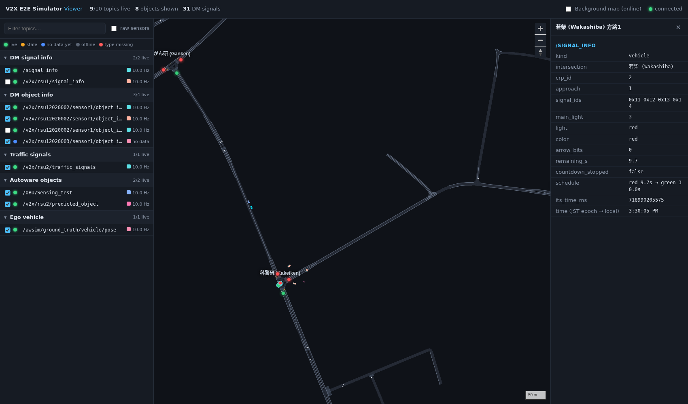
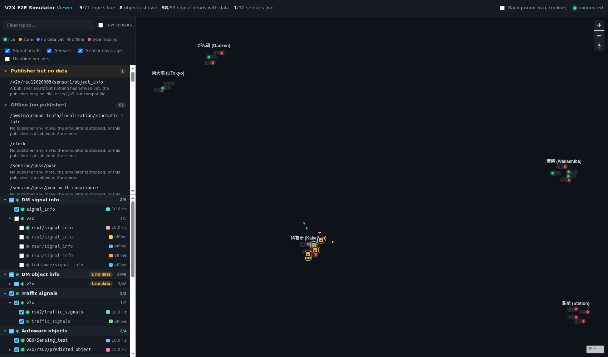
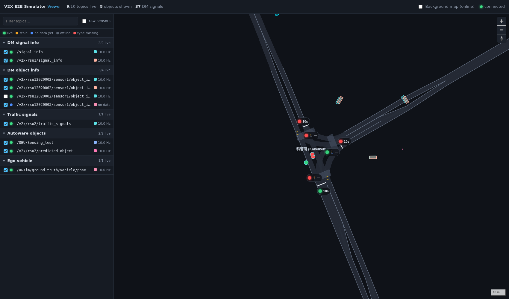
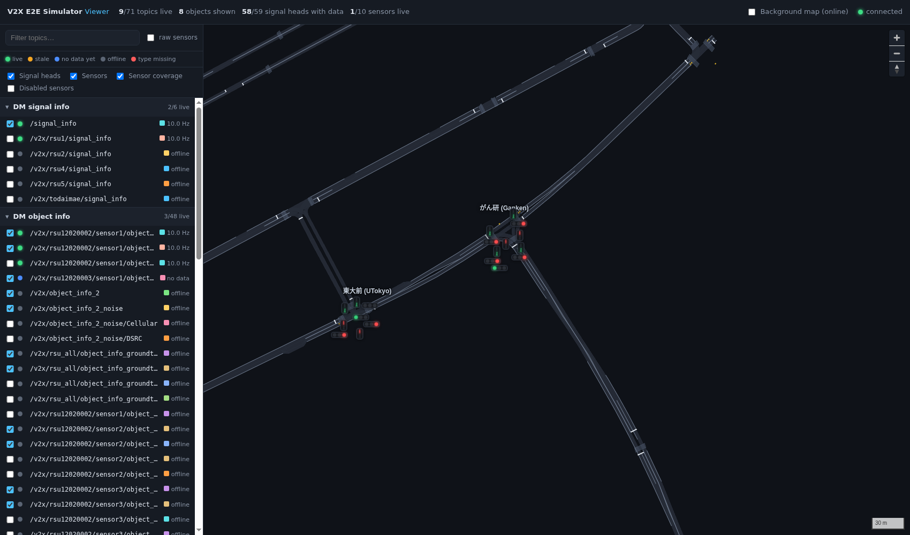

# Web Viewer

The web viewer is a local web page that answers two questions while the simulator runs:

1. **Which topics are live?** Every topic the simulator publishes is listed with its status, rate and last-message age.
2. **What do they say?** Everything except raw sensor data is drawn on the Kashiwa Lanelet2 map: DM object info, DM signal info with remaining time, V2X and Autoware traffic signals, Autoware objects and the ego vehicle.

It lives in `tools/web-viewer/` and runs on the simulator machine only.



## Start

```console
cd V2X_E2E_Simulator
tools/web-viewer/run.sh
```

Then open **http://localhost:8080**. Start the simulator before or after; the viewer picks up topics as they appear.

`run.sh` does the setup:

- sources ROS 2 Humble and the [v2x_e2e_msgs](https://github.com/tlab-wide/v2x_e2e_msgs) workspace, which it expects at `../v2x_e2e_msgs/install` next to the simulator folder. Override this with `MSGS_SETUP=/path/to/install/setup.bash`.
- uses the simulator's middleware settings: `RMW_IMPLEMENTATION=rmw_cyclonedds_cpp` and `ROS_LOCALHOST_ONLY=1`.
- on the first run, creates `tools/web-viewer/.venv` with `aiohttp`, leaving the system Python untouched.

Options: `--port 9000` changes the port. The server binds to `127.0.0.1`, so the page cannot be opened from another computer.

## How it works

```text
 Simulator ──ROS 2──► server/main.py  (one Python process, rclpy + aiohttp)
                       ├─ monitor.py   discovers topics every second, subscribes to each non-raw topic,
                       │               measures rate / last-message age, keeps the latest message
                       ├─ decoders.py  turns the latest messages into map features (≤ 10 Hz),
                       │               only for the topics ticked in the page
                       └─ WebSocket /ws ──► browser: topic list (1 Hz) + map layers (≤ 10 Hz)
```

No Foxglove, rosbridge or other ROS packages are needed. The server subscribes with *best effort* QoS, which matches both reliable and best-effort publishers. Raw sensor types (`PointCloud2`, `Image`, `CameraInfo`, `LaserScan`, `Imu`, `NavSatFix`, …) are listed but never subscribed to.

## Topic panel

### Problems

Every topic with an issue is listed at the top of the sidebar, grouped by reason. Each group has a short explanation, and each topic its details. Click a topic to open it in the inspector.

| Group | Meaning | What to check |
|:--|:--|:--|
| 🔴 Message type missing | The type is not in the sourced message workspace, so the topic cannot be received or decoded (e.g. `/OBU/Sensing`, Autoware `DetectedObjects`). | Rebuild `v2x_e2e_msgs` with that type, or set `MSGS_SETUP` to a workspace that has it. |
| 🔵 Publisher but no data | A publisher exists but nothing has arrived. | The publisher may be idle, or its QoS is incompatible. |
| 🟠 Stopped publishing | Messages arrived before but stopped (shows how long ago). | The simulator is paused, or the publisher stopped. |
| ⚫ Offline (no publisher) | The publisher is gone. Folded by default. | The simulator is stopped, or the publisher is disabled in the scene. |

When **every** topic is offline, the panel shows a single "Simulator not publishing" notice instead of the long list.

### Topic tree

Below the problems, topics are grouped by category: DM signal info, DM object info, traffic signals, Autoware objects, ego vehicle, control, clock and other. Within each category they form a tree that follows the topic names, for example `v2x › rsu12020002 › sensor1 › object_info_noise › DSRC`. Namespaces with a single child are merged (`awsim/ground_truth`).

- **Branches** show how many of their topics are live (`3/20`) and badges for problems inside them (`1 no data`, `2 type missing`). Their checkbox ticks or unticks every drawable topic below them; it is part-filled when only some are ticked.
- **Topics** show their status dot, rate or problem, and colour swatch. A topic with delayed copies (`/DSRC`, `/Cellular`) has a ▸ to show them.
- Branches with more than six topics, and every topic's delayed copies, start folded. Typing in the filter box expands everything that matches. The folding and tick choices are remembered in the browser.

| Status dot | Meaning |
|:--|:--|
| 🟢 live | Messages are arriving; the rate is measured over the last 3 s. |
| 🟠 stale | Messages arrived before but have stopped (the age is shown). |
| 🔵 no data yet | A publisher exists but nothing has been received. |
| ⚫ offline | No publisher any more (e.g. the simulator was stopped). |
| 🔴 type missing | The message type is not in the sourced workspace, so the topic cannot be decoded. |
| half green | (branches) some, but not all, topics below are live |

Tick a topic to draw it on the map. Click its name to see its type, publishers, rate, message count, bandwidth and a summary of the last message. Delayed copies (`…/DSRC`, `…/Cellular`) start unticked, because they duplicate other topics.



## Map layers

| Data | Topic types | How it is placed |
|:--|:--|:--|
| Lanelet2 map | `maps/lanelet2.geojson` | Lanes, lane borders, crosswalks, stop lines and traffic-light positions |
| DM object info | `dm_object_info_msgs/ObjectInfoArray` | Latitude/longitude and heading from the message, drawn as boxes of the reported size |
| Signal heads | `dm_signal_info_msgs/SignalInfoArray`, `v2x_msgs/V2XSignals`, Autoware `TrafficSignalArray` / `TrafficLightGroupArray` | At the real signal positions of `config/traffic_lights.yaml` (see [Signal heads](#signal-heads)) |
| Other traffic lights | V2X / Autoware traffic signals whose ID is not in the config | A dot at the Lanelet2 traffic light with that regulatory-element or way ID |
| RSU sensors | `config/sensors.yaml` + health of their object-info topics | Sensor icon and field-of-view sector (see [Sensors](#sensors)) |
| Autoware objects | `PredictedObjects`, `DetectedObjects`, `TrackedObjects` | Map frame (`map`, `obj`) converted to lat/lon. Ego-relative frames such as `bus` are placed with the ego pose. |
| Ego vehicle | `/awsim/ground_truth/vehicle/pose` and other `PoseStamped` / `Odometry` topics in the map frame | Cyan box |

Each topic has its own colour (the swatch in the list). Layers of topics that are not live are dimmed. Click any object or signal to open the inspector. It shows the decoded fields: for example the object ID split into RSU / sensor / object number, the CooL4 light colour and the full remaining-time schedule.



The **overlay toggles** under the legend switch the signal heads, the sensors, the sensor coverage sectors and the disabled sensors on and off. Overlapping heads and sensors (several on one pole) are stacked automatically.

**Background map (online)** overlays GSI tiles when the machine has internet. Everything else, including the Lanelet2 map, works offline.

## Signal heads

Every vehicle and pedestrian signal head of the five bus-route intersections is drawn where it stands. Positions come from `config/traffic_lights.yaml`.

| Head | Shows |
|:--|:--|
| Vehicle | Three bulbs in Japanese order (green, yellow, red, left to right), green arrows (← ↑ →) if lit, remaining seconds |
| Pedestrian | Stop (red) and walk (green) figures, remaining seconds; a flashing walk figure is 青点滅 |

Flashing lights blink. Zoomed out (below 17.3) the heads show bulbs only; below 15.8 they are hidden.

**Where the state comes from**, in order of preference:

1. **CooL4 DM signal info**: the SignalInfo whose `crp_id` matches the intersection and whose `signal_id_list` contains one of the head's `dm_signal_ids`. Only DM carries the **remaining time** (`min_time_to_change`); "—" means the light never changes (countdown stopped).
2. **V2X / Autoware traffic signals** (vehicle heads only): the signal whose ID is one of the head's `lanelet_regulatory_elements` or `lanelet_light_ways`. These messages have no remaining time, so no seconds are shown.

A head with no data is greyed out; a head fed by a topic that is not live is dimmed with a dashed border. Click a head to see both sources side by side: the DM light, remaining time and full schedule, and the V2X/Autoware elements.



### config/traffic_lights.yaml

A human-readable file, one block per intersection and approach (方路):

```yaml
intersections:
  - name: 科警研 (Kakeiken)
    crp_id: 798721            # 0x000c3001
    unity_intersection: 'crossroad2'
    center: {lat: 35.896047, lon: 139.94182}
    approaches:
      - id: 2                  # 方路2
        direction: south
        bearing_deg: 160        # from the centre towards this leg
        vehicle:
          dm_signal_ids: [0x21, 0x22, 0x23]
          lanelet_regulatory_elements: [166940]
          lanelet_light_ways: [166935, 166947]
          heads:
            - {lat: 35.895915, lon: 139.94194, facing_deg: 160}
            - {lat: 35.8961811, lon: 139.9417231, facing_deg: 160}
        pedestrian:                 # crosswalk across this approach
          dm_signal_ids: [0x20]
          heads:
            - {lat: 35.8959157, lon: 139.9418385, facing_deg: 160}
            - {lat: 35.8959551, lon: 139.9419562, facing_deg: 160}
```

- **Vehicle heads** were placed on the Lanelet2 `traffic_light` poles of the regulatory elements whose lanes enter from that approach. These are the same regulatory elements the simulator's `TrafficLightLaneletID` components carry.
- **Pedestrian heads** sit at the two ends of the crosswalk across the approach; the Lanelet2 map has no pedestrian lights. 東大前 方路1 has no crosswalk in the map, so it has no pedestrian head. Add one by hand if needed.
- **Editing:** move a head by changing its `lat`/`lon`, add or remove heads freely. Restart the viewer to load the change.
- **Re-deriving positions:** `python3 tools/web-viewer/scripts/build_signal_config.py /path/to/lanelet2_map.osm` fills only approaches without heads. `--force` recomputes all of them, overwriting hand edits.

## Sensors

The RSU pseudo sensors (`MockSensor`) are listed in `config/sensors.yaml`, extracted from the Kashiwa scene (`V2X_E2E_Simulator_v3.1.0.unity`). Each sensor is drawn as an icon (C = camera, L = lidar) with its coverage sector. The icon gets a green halo when one of its object-info topics is live. Labels appear from zoom 18. Click a sensor for all its settings and the live status of its topics.

```yaml
sensors:
  - name: 'RSU_camera 5'
    type: RSU_CAMERA
    enabled: true
    near: '科警研 (Kakeiken)'        # 19 m from the centre
    sensor_id: 1
    rsu_ids: [0x1100, 0x12020002]
    position: {lat: 35.8961753, lon: 139.9419667, z_m: 23.71}
    heading_deg: 234.4
    pitch_deg: -35.0
    h_fov_deg: 42.4
    v_fov_deg: 22.65
    range_m: 75.0
    topics:
      - /v2x/object_info_2_noise
      - /v2x/object_info_2
      - /v2x/rsu12020002/sensor1/object_info_noise
      - /v2x/rsu12020002/sensor1/object_info
```

| Field | Meaning |
|:--|:--|
| `type` | `RSU_CAMERA` or `RSU_LIDAR` (`MockSensorType`) |
| `enabled` | Active in the scene. The 10 sensors of the Kakeiken CooL4 setup are enabled; the others belong to disabled setups and are shown only with **Disabled sensors** ticked. |
| `position`, `heading_deg`, `pitch_deg` | World pose of the sensor (heading clockwise from north) |
| `h_fov_deg`, `v_fov_deg` | **Half-angles**, as `MockSensor` uses them (it detects \|yaw\| ≤ `Hfov`), so the drawn sector is 2 × `h_fov_deg` wide |
| `range_m` | `MockSensor.maxDistance` |
| `rsu_ids`, `topics` | The active CooL4 DM object-info publishers (`ObjectInfo`) that use the sensor |

The file is not regenerated automatically. If you move or add sensors in the scene, update it by hand.

## Coordinates

| Source | Conversion |
|:--|:--|
| DM messages | Already WGS84 (1e-7 deg) |
| Autoware / AWSIM `map` frame | Local coordinates of MGRS square 54SVE: `UTM(EPSG:32654) = map_xy + (400000, 3900000)`. `build_map.py` derives this offset from the Lanelet2 `local_x`/`local_y` tags (residual 0 m). |
| Ego-relative frames | Rotated and translated with the latest ego pose |

## Using another map or intersections

- **Map:** `python3 tools/web-viewer/scripts/build_map.py /path/to/lanelet2_map.osm` regenerates `maps/lanelet2.geojson` and `maps/lanelet2_meta.json`.
- **Signal heads:** edit `config/traffic_lights.yaml` (see [Signal heads](#signal-heads)). The CRP and signal IDs match the [Signal Info](../../DMProtocols/CooL4/SignalInfo/index.md) mapping.
- **Sensors:** edit `config/sensors.yaml` (see [Sensors](#sensors)).

## Troubleshooting

| Symptom | Check |
|:--|:--|
| "No topics yet" | Is the simulator running? Are `ROS_DOMAIN_ID` and `ROS_LOCALHOST_ONLY` the same in both terminals? |
| A topic shows *type missing* | The type is not in the sourced `v2x_e2e_msgs` build. Rebuild the workspace, or point `MSGS_SETUP` to one that has it. |
| Autoware objects in a relative frame are not drawn | The ego pose topic `/awsim/ground_truth/vehicle/pose` must be live; the topic summary says so. |
| Port already in use | `run.sh --port 9000` |
